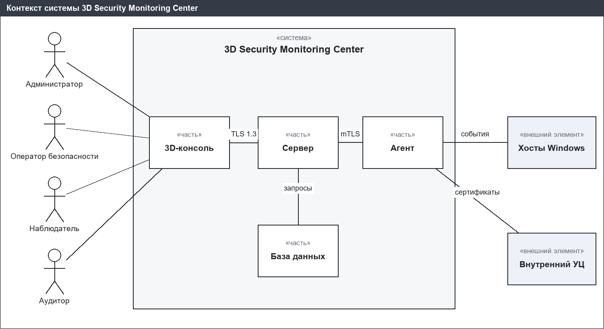
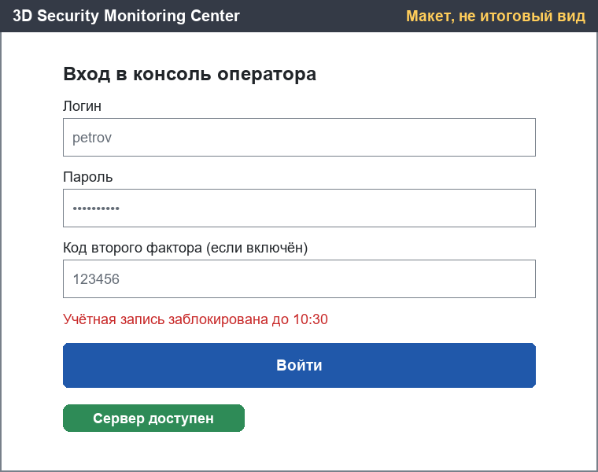
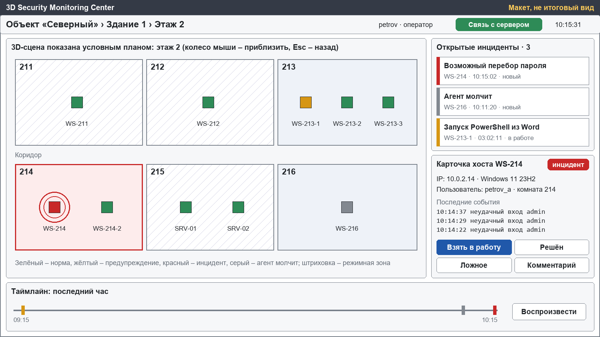
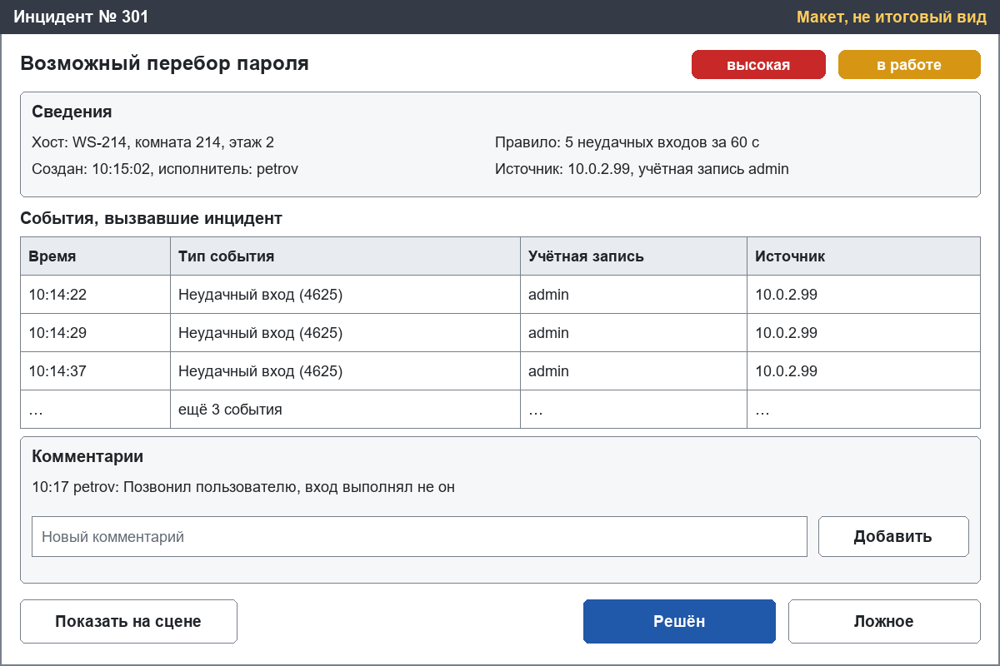
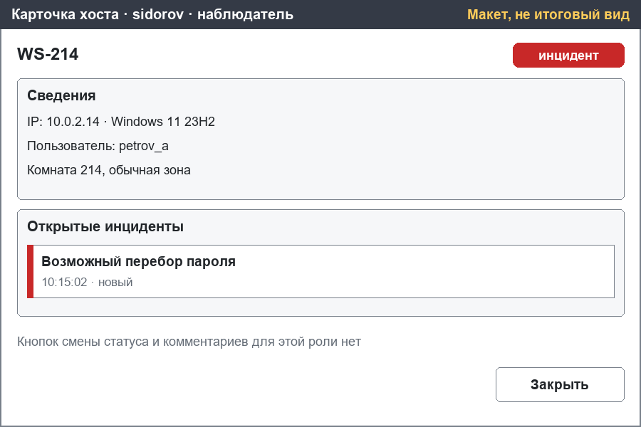
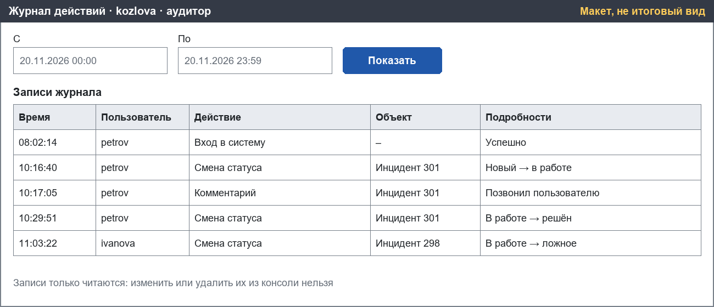
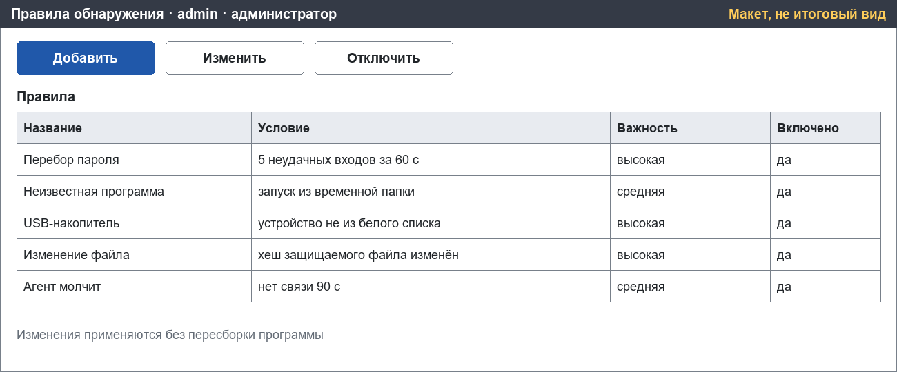

# Спецификация требований к ПО

Для 3D Security Monitoring Center

Версия 0.1

Подготовил Мороз А. А., гр. 434701

БГУИР, Военный факультет

2026-11-06

## Оглавление

<!-- TOC -->
* [1. Введение](#1-введение)
  * [1.1 Назначение документа](#11-назначение-документа)
  * [1.2 Область применения продукта](#12-область-применения-продукта)
  * [1.3 Определения, акронимы и сокращения](#13-определения-акронимы-и-сокращения)
  * [1.4 Ссылки](#14-ссылки)
  * [1.5 Обзор документа](#15-обзор-документа)
* [2. Обзор продукта](#2-обзор-продукта)
  * [2.1 Перспектива продукта](#21-перспектива-продукта)
  * [2.2 Функции продукта](#22-функции-продукта)
  * [2.3 Ограничения продукта](#23-ограничения-продукта)
  * [2.4 Характеристики пользователей](#24-характеристики-пользователей)
  * [2.5 Допущения и зависимости](#25-допущения-и-зависимости)
  * [2.6 Распределение требований](#26-распределение-требований)
* [3. Требования](#3-требования)
  * [3.1 Внешние интерфейсы](#31-внешние-интерфейсы)
    * [3.1.1 Пользовательские интерфейсы](#311-пользовательские-интерфейсы)
    * [3.1.2 Аппаратные интерфейсы](#312-аппаратные-интерфейсы)
    * [3.1.3 Программные интерфейсы](#313-программные-интерфейсы)
  * [3.2 Функциональные требования](#32-функциональные-требования)
  * [3.3 Качество обслуживания](#33-качество-обслуживания)
    * [3.3.1 Производительность](#331-производительность)
    * [3.3.2 Безопасность](#332-безопасность)
    * [3.3.3 Надёжность](#333-надёжность)
    * [3.3.4 Доступность](#334-доступность)
    * [3.3.5 Наблюдаемость](#335-наблюдаемость)
  * [3.4 Соответствие стандартам](#34-соответствие-стандартам)
  * [3.5 Проектирование и реализация](#35-проектирование-и-реализация)
    * [3.5.1 Установка](#351-установка)
    * [3.5.2 Сборка и поставка](#352-сборка-и-поставка)
    * [3.5.3 Распределение](#353-распределение)
    * [3.5.4 Сопровождаемость](#354-сопровождаемость)
    * [3.5.5 Повторное использование](#355-повторное-использование)
    * [3.5.6 Переносимость](#356-переносимость)
    * [3.5.7 Стоимость](#357-стоимость)
    * [3.5.8 Сроки](#358-сроки)
    * [3.5.9 Доказательство концепции](#359-доказательство-концепции)
    * [3.5.10 Управление изменениями](#3510-управление-изменениями)
  * [3.6 ИИ/МО](#36-иимо)
* [4. Верификация](#4-верификация)
* [5. Приложения](#5-приложения)
<!-- TOC -->

## История изменений

| Name | Date | Reason For Changes | Version |
|------|------|--------------------|---------|
| Мороз А. А. | 2026-11-06 | Первая редакция для рассмотрения Заказчиком | 0.1 |

---

## 1. Введение

Документ задаёт требования к системе мониторинга информационной безопасности 3D Security Monitoring Center. Система показывает инциденты на трёхмерной модели здания, поэтому оператор сразу видит, в каком помещении находится атакованный компьютер. Назначение документа описано в разделе 1.1, границы продукта в разделе 1.2, а его структура в разделе 1.5.

### 1.1 Назначение документа

Спецификация определяет, **что** должна делать система, и не описывает её внутреннее устройство. Заказчик использует документ для согласования состава работ, разработчик для проектирования, а проверяющий для составления тестов. Решения о том, как система будет построена, фиксируются в документах SDD и ADR.

### 1.2 Область применения продукта

3D Security Monitoring Center версии 1.0 является компактной хостовой системой обнаружения вторжений с трёхмерной консолью оператора. Агенты на компьютерах собирают события безопасности, сервер обнаруживает по ним нарушения, а консоль показывает инциденты на модели объекта.

Классические системы мониторинга показывают инциденты таблицами. Оператор вручную переводит запись «WS-214, событие 4625» в «компьютер в кабинете 214» и теряет на этом время. При атаке на несколько компьютеров теряется и общая картина. Коммерческие SIEM дороги, сложны и избыточны для небольшого подразделения.

Бизнес-цели продукта:

| ID | Бизнес-цель | Как проверяется достижение |
|----|-------------|----------------------------|
| BG-01 | Сократить время от события до понимания, где оно произошло | Инцидент появляется на модели здания не позже 3 секунд после события |
| BG-02 | Автоматически обнаруживать типовые нарушения на всех компьютерах | Типовые сценарии атак на стенде создают инциденты |
| BG-03 | Дать небольшому подразделению доступную систему | Нет лицензионных платежей, развёртывание на одном сервере |
| BG-04 | Обеспечить защиту самой системы и контроль действий операторов | Действия записываются, изменение журнала обнаруживается |
| BG-05 | Сохранять данные для расследований | События хранятся не меньше 90 дней |

В продукт входят агент для Windows, сервер, база данных и 3D-консоль. В продукт не входят агент для Linux и автоматическая блокировка атак: система только обнаруживает и показывает инциденты.

Контекст системы изображён на рисунке [system-context.png](images/system-context.png).

### 1.3 Определения, акронимы и сокращения

| Term | Definition |
|------|------------|
| Агент | Служба на контролируемом компьютере, которая собирает события и отправляет их серверу |
| Заказчик | Сторона, формулирующая бизнес-требования к системе |
| Зона | Категория помещения: обычная, служебная или режимная |
| Инцидент | Запись о нарушении, созданная при срабатывании правила обнаружения |
| Консоль | Клиентское приложение с 3D-сценой, через которое работают пользователи |
| Правило обнаружения | Условие над потоком событий, при выполнении которого создаётся инцидент |
| Сервер | Компонент, принимающий события, применяющий правила и обслуживающий консоли |
| Событие | Запись о действии на хосте, например неудачный вход |
| УЦ | Удостоверяющий центр, выпускающий сертификаты агентов |
| Хост | Контролируемый компьютер с установленным агентом |
| API | Application Programming Interface – набор определений и протоколов для создания и интеграции прикладного ПО |
| CI | Continuous Integration – автоматическая сборка и проверка при изменении кода |
| HIDS | Host-based Intrusion Detection System – хостовая система обнаружения вторжений |
| mTLS | Mutual TLS – TLS с проверкой сертификатов обеих сторон |
| SIEM | Security Information and Event Management – система управления событиями безопасности |
| SRS | Software Requirements Specification – документ, описывающий назначение, требования и характер ПО |
| SysML | Systems Modeling Language – язык моделирования систем |
| TLS | Transport Layer Security – протокол защиты передаваемых данных |
| UI | User Interface – визуальная часть приложения, через которую пользователь взаимодействует с ПО |
| USB | Universal Serial Bus – последовательная шина для подключения устройств |

### 1.4 Ссылки

| Документ | Версия или дата | Расположение | Вид |
|----------|-----------------|--------------|-----|
| ISO/IEC/IEEE 29148 Requirements engineering | 2018 | [docs/standards.md](../docs/standards.md) | Нормативная |
| Шаблон спецификации требований | 2026 | [srs/srs-template.md](srs-template.md) | Нормативная |
| OMG Systems Modeling Language (SysML) | Версия 2 | https://www.omg.org/sysml/ | Справочная |
| RFC 8446, TLS 1.3 | 2018 | https://www.rfc-editor.org/rfc/rfc8446 | Справочная |
| Модели экранов и контекста | 2026-11-06 | [srs/models](models) | Справочная |

### 1.5 Обзор документа

Раздел 2 описывает контекст, пользователей и ограничения. Раздел 3 содержит требования с идентификаторами вида `REQ-[AREA]-[NNN]`. Раздел 4 содержит матрицу верификации, раздел 5 перечисляет мокапы и модели. В требованиях слово «должен» означает обязательность для указанного в поле More Information приоритета. Изменения вносятся через pull-request и записываются в историю изменений.

---

## 2. Обзор продукта

Раздел описывает окружение продукта и условия, в которых действуют требования раздела 3.

### 2.1 Перспектива продукта

Продукт является новым и не заменяет существующую систему. Он работает во внутренней сети организации и получает данные от операционных систем контролируемых компьютеров. Внешними элементами являются хосты и внутренний удостоверяющий центр, который выпускает сертификаты агентов. Соглашения об уровне обслуживания не заключаются.

### 2.2 Функции продукта

- сбор событий безопасности на хостах и их доставка на сервер;
- обнаружение нарушений по настраиваемым правилам;
- создание инцидентов и связывание их с событиями;
- показ состояния хостов на 3D-модели объекта в реальном времени;
- разбор инцидентов операторами со статусами и комментариями;
- разграничение возможностей по четырём ролям;
- защищённое журналирование действий пользователей;
- хранение событий и инцидентов для расследований.

### 2.3 Ограничения продукта

| № | Ограничение | Вид |
|---|-------------|-----|
| 1 | Агент должен работать на Windows 10 22H2 и Windows 11 x64 | Внешнее, обязательное |
| 2 | Система должна работать без платных лицензий и внешних сервисов | Внешнее, обязательное |
| 3 | Заказчик должен иметь доступ к исходному коду для аудита | Внешнее, обязательное |
| 4 | Все каналы связи должны быть зашифрованы | Внешнее, обязательное |
| 5 | Сервер и агент должны быть написаны на C++, консоль на Unreal Engine 5, данные должны храниться в PostgreSQL 16 | Внутреннее, обязательное |

Движок Unreal Engine 5 используется на условиях лицензии Epic Games без лицензионных платежей.

### 2.4 Характеристики пользователей

| Роль | Задачи | Доступ | Подготовка |
|------|--------|--------|------------|
| Администратор | Управляет хостами, агентами, правилами и пользователями | Настройки, журнал действий, инциденты | Системный администратор |
| Оператор безопасности | Разбирает инциденты, меняет статус, пишет комментарии | Инциденты, карта | Специалист по защите информации |
| Наблюдатель | Смотрит карту и статистику | Только чтение | Базовая работа с ПК |
| Аудитор | Читает журнал действий операторов | Только журнал действий | Специалист по контролю |

Интерфейс рассчитан на русский язык и работу на компьютере с мышью и клавиатурой.

### 2.5 Допущения и зависимости

| № | Допущение | Влияние, если неверно |
|---|-----------|------------------------|
| 1 | На хостах включён аудит событий безопасности Windows | Агент не получит часть событий, понадобится настройка политики |
| 2 | Хосты имеют сетевой доступ к серверу | Часть событий будет доставлена с задержкой |
| 3 | Для объекта есть план помещений и данные о размещении хостов | Сцену нельзя построить без подготовки данных |
| 4 | Рабочее место оператора имеет видеокарту требуемого уровня | Не будет выполнено требование к частоте кадров |
| 5 | Unreal Engine 5 остаётся доступным без лицензионных платежей | Потребуется пересмотр ограничений |

### 2.6 Распределение требований

Требования с приоритетом «обязательно» входят в первую версию, остальные относятся к следующим инкрементам.

| Подсистема | Первая версия (обязательно) | Следующие инкременты |
|---|---|---|
| Агент | REQ-INT-005, REQ-INT-006, REQ-FUNC-001, REQ-FUNC-002, REQ-FUNC-005, REQ-FUNC-007, REQ-FUNC-008, REQ-FUNC-009, REQ-PERF-003, REQ-REL-001, REQ-INST-001, REQ-PORT-001 | REQ-FUNC-003, REQ-FUNC-004, REQ-FUNC-006, REQ-SEC-011, REQ-MAINT-001 |
| Сервер | REQ-FUNC-010, REQ-FUNC-011, REQ-FUNC-012, REQ-FUNC-013, REQ-FUNC-014, REQ-FUNC-015, REQ-SEC-002, REQ-SEC-003, REQ-SEC-004, REQ-SEC-005, REQ-SEC-006, REQ-OBS-001 | REQ-FUNC-016, REQ-FUNC-017, REQ-PERF-002, REQ-SEC-007, REQ-SEC-008, REQ-SEC-009, REQ-AVAIL-001 |
| Консоль | REQ-INT-001, REQ-INT-002, REQ-INT-003, REQ-INT-004, REQ-FUNC-018, REQ-FUNC-019, REQ-FUNC-020, REQ-FUNC-021, REQ-FUNC-022, REQ-FUNC-023, REQ-FUNC-025, REQ-PERF-004, REQ-REL-002, REQ-REUSE-001 | REQ-FUNC-024, REQ-FUNC-028, REQ-FUNC-029 |
| База данных | REQ-INT-009 | REQ-PERF-005, REQ-SEC-010 |
| Вся система | REQ-INT-007, REQ-INT-008, REQ-FUNC-026, REQ-FUNC-027, REQ-PERF-001, REQ-SEC-001, REQ-COMP-001, REQ-COMP-002, REQ-COMP-003, REQ-BUILD-001, REQ-DIST-001, REQ-COST-001, REQ-POC-001, REQ-CM-001 | REQ-FUNC-030, REQ-SEC-012, REQ-SEC-013, REQ-DEAD-001 |

---

## 3. Требования

Требования сформулированы по шаблону с полями ID, Title, Statement, Rationale, Acceptance Criteria, Verification Method и More Information. Идентификаторы имеют вид `REQ-[AREA]-[NNN]`, они уникальны и не меняются. Приоритет указан в поле More Information.

| Группа требований | Количество |
|---|---|
| Функциональные | 30 |
| Внешние интерфейсы | 9 |
| Производительность | 5 |
| Безопасность | 13 |
| Надёжность | 2 |
| Доступность | 1 |
| Наблюдаемость | 1 |
| Соответствие стандартам | 3 |
| Проектирование и реализация | 10 |
| **Всего** | **74** |

### 3.1 Внешние интерфейсы

Раздел определяет, как система взаимодействует с пользователями, устройствами и другими программами.

#### 3.1.1 Пользовательские интерфейсы

Мокапы экранов перечислены в разделе 5. Они являются предварительными макетами: обязательны требования этого раздела, а не оформление на изображениях.

- **ID:** REQ-INT-001
- **Title:** Язык интерфейса
- **Statement:** Консоль должна показывать все надписи и сообщения на русском языке.
- **Rationale:** Операторы работают на русском языке, перевод сообщений замедляет разбор инцидента.
- **Acceptance Criteria:** На всех экранах нет надписей на другом языке, кроме имён хостов, учётных записей и кодов событий.
- **Verification Method:** Inspection
- **More Information:** Бизнес-цель: BG-01. Приоритет: обязательно. Подсистема: Консоль.

- **ID:** REQ-INT-002
- **Title:** Состав главного экрана
- **Statement:** Главный экран консоли должен одновременно показывать 3D-сцену, список открытых инцидентов и карточку выбранного хоста.
- **Rationale:** Оператор видит место, список и подробности без переключения окон.
- **Acceptance Criteria:** При разрешении 1920×1080 на экране одновременно видны 3D-сцена, список инцидентов и карточка хоста. Примерное расположение показано на макете [ui-main.png](images/ui-main.png).
- **Verification Method:** Demonstration
- **More Information:** Бизнес-цель: BG-01. Приоритет: обязательно. Подсистема: Консоль.

- **ID:** REQ-INT-003
- **Title:** Сообщения об ошибках
- **Statement:** Консоль должна показывать понятное сообщение при неверном пароле, блокировке, нехватке прав, отсутствии объекта и ошибке сервера.
- **Rationale:** Без сообщения пользователь не поймёт, почему действие не выполнено.
- **Acceptance Criteria:** Для каждого из пяти случаев выводится отдельный текст, программа продолжает работать.
- **Verification Method:** Test
- **More Information:** Бизнес-цель: BG-01. Приоритет: обязательно. Подсистема: Консоль.

#### 3.1.2 Аппаратные интерфейсы

- **ID:** REQ-INT-004
- **Title:** Рабочее место оператора
- **Statement:** Консоль должна работать на компьютере с видеокартой уровня NVIDIA GTX 1060 или выше.
- **Rationale:** Такое оборудование доступно небольшому подразделению.
- **Acceptance Criteria:** Консоль запускается на указанной видеокарте и выполняет [REQ-PERF-004](#331-производительность).
- **Verification Method:** Test
- **More Information:** Бизнес-цель: BG-03. Приоритет: обязательно. Подсистема: Консоль.

- **ID:** REQ-INT-005
- **Title:** Контролируемые устройства
- **Statement:** Агент должен определять подключение USB-накопителей средствами операционной системы хоста.
- **Rationale:** Съёмные носители являются частым каналом утечки и заражения.
- **Acceptance Criteria:** Подключение накопителя регистрируется на Windows 10 22H2 и Windows 11.
- **Verification Method:** Test
- **More Information:** Бизнес-цель: BG-02. Приоритет: обязательно. Подсистема: Агент.

#### 3.1.3 Программные интерфейсы

- **ID:** REQ-INT-006
- **Title:** Источники событий
- **Statement:** Агент должен получать события из журнала безопасности Windows.
- **Rationale:** Журнал содержит сведения о входах, процессах и учётных записях.
- **Acceptance Criteria:** События с кодами 4624, 4625 и 4688 попадают в систему.
- **Verification Method:** Test
- **More Information:** Бизнес-цель: BG-02. Приоритет: обязательно. Подсистема: Агент. Код 4625 соответствует неудачному входу.

- **ID:** REQ-INT-007
- **Title:** Канал между агентом и сервером
- **Statement:** Агент и сервер должны обмениваться пачками событий и подтверждениями по защищённому каналу.
- **Rationale:** Подтверждение нужно, чтобы не потерять события при обрыве связи.
- **Acceptance Criteria:** Неподтверждённая пачка отправляется повторно, принятая не сохраняется дважды.
- **Verification Method:** Test
- **More Information:** Бизнес-цель: BG-02. Приоритет: обязательно. Подсистема: Вся система.

- **ID:** REQ-INT-008
- **Title:** Канал между консолью и сервером
- **Statement:** Консоль и сервер должны обмениваться запросами, ответами и уведомлениями в реальном времени по защищённому каналу.
- **Rationale:** Оператор узнаёт об инциденте без ручного обновления экрана.
- **Acceptance Criteria:** Новый инцидент появляется в консоли без действий оператора, неверное сообщение возвращает код ошибки.
- **Verification Method:** Test
- **More Information:** Бизнес-цель: BG-01. Приоритет: обязательно. Подсистема: Вся система.

- **ID:** REQ-INT-009
- **Title:** Хранилище данных
- **Statement:** Система должна хранить данные в СУБД PostgreSQL версии 16.
- **Rationale:** PostgreSQL бесплатна и поддерживает разбиение больших таблиц.
- **Acceptance Criteria:** Система запускается на PostgreSQL 16 и сохраняет данные после перезапуска сервера.
- **Verification Method:** Test
- **More Information:** Бизнес-цель: BG-03. Приоритет: обязательно. Подсистема: База данных.

### 3.2 Функциональные требования

**Агент**

- **ID:** REQ-FUNC-001
- **Title:** Сбор событий входа
- **Statement:** Агент должен собирать события успешного и неудачного входа в систему.
- **Rationale:** Подбор пароля является основным сценарием обнаружения.
- **Acceptance Criteria:** Неудачный вход на хосте появляется в базе с учётной записью и адресом источника.
- **Verification Method:** Test
- **More Information:** Бизнес-цель: BG-02. Приоритет: обязательно. Подсистема: Агент.

- **ID:** REQ-FUNC-002
- **Title:** Сбор запуска процессов
- **Statement:** Агент должен собирать события запуска процессов с путём к файлу и родительским процессом.
- **Rationale:** Путь и родитель нужны для выявления неизвестных программ.
- **Acceptance Criteria:** Запуск программы регистрируется с полным путём и родительским процессом.
- **Verification Method:** Test
- **More Information:** Бизнес-цель: BG-02. Приоритет: обязательно. Подсистема: Агент.

- **ID:** REQ-FUNC-003
- **Title:** Сбор изменений учётных записей
- **Statement:** Агент должен собирать события создания и изменения учётных записей.
- **Rationale:** Новая учётная запись может быть следом закрепления нарушителя.
- **Acceptance Criteria:** Создание учётной записи на хосте появляется в базе.
- **Verification Method:** Test
- **More Information:** Бизнес-цель: BG-02. Приоритет: желательно. Подсистема: Агент.

- **ID:** REQ-FUNC-004
- **Title:** Контроль защищаемых файлов
- **Statement:** Агент должен по расписанию вычислять хеш защищаемых файлов и сообщать об изменении.
- **Rationale:** Изменение критичного файла может быть признаком атаки.
- **Acceptance Criteria:** Изменение файла из списка обнаруживается при следующей проверке.
- **Verification Method:** Test
- **More Information:** Бизнес-цель: BG-02. Приоритет: желательно. Подсистема: Агент.

- **ID:** REQ-FUNC-005
- **Title:** Контроль USB-накопителей
- **Statement:** Агент должен сообщать о подключении USB-накопителя с идентификатором устройства.
- **Rationale:** Заказчику важен контроль съёмных носителей.
- **Acceptance Criteria:** Событие содержит идентификатор устройства и имя хоста.
- **Verification Method:** Test
- **More Information:** Бизнес-цель: BG-02. Приоритет: обязательно. Подсистема: Агент.

- **ID:** REQ-FUNC-006
- **Title:** Контроль сетевых портов
- **Statement:** Агент должен сообщать о новых слушающих сетевых портах.
- **Rationale:** Новый порт может указывать на постороннюю программу.
- **Acceptance Criteria:** Открытие нового порта создаёт событие с номером порта и процессом.
- **Verification Method:** Test
- **More Information:** Бизнес-цель: BG-02. Приоритет: если хватит времени. Подсистема: Агент.

- **ID:** REQ-FUNC-007
- **Title:** Единый формат событий
- **Statement:** Агент должен приводить события к единому формату: хост, время, тип, важность, учётная запись, подробности.
- **Rationale:** Единый формат позволяет применять одни правила ко всем источникам.
- **Acceptance Criteria:** Все события в базе содержат перечисленные поля.
- **Verification Method:** Analysis
- **More Information:** Бизнес-цель: BG-02. Приоритет: обязательно. Подсистема: Агент.

- **ID:** REQ-FUNC-008
- **Title:** Контроль работы агента
- **Statement:** Агент должен сообщать серверу о своей работе каждые 30 секунд.
- **Rationale:** Отсутствие сигнала показывает, что агент отключён или хост недоступен.
- **Acceptance Criteria:** Сервер получает сигнал не реже одного раза в 30 секунд.
- **Verification Method:** Test
- **More Information:** Бизнес-цель: BG-02. Приоритет: обязательно. Подсистема: Агент.

- **ID:** REQ-FUNC-009
- **Title:** Запуск агента как службы
- **Statement:** Агент должен работать как служба Windows и запускаться автоматически.
- **Rationale:** Сбор событий не должен зависеть от действий пользователя хоста.
- **Acceptance Criteria:** После перезагрузки хоста агент работает без входа пользователя.
- **Verification Method:** Test
- **More Information:** Бизнес-цель: BG-02. Приоритет: обязательно. Подсистема: Агент.

**Сервер**

- **ID:** REQ-FUNC-010
- **Title:** Приём и хранение событий
- **Statement:** Сервер должен принимать события от агентов и сохранять их в базе данных.
- **Rationale:** Сохранённые события нужны для обнаружения и расследований.
- **Acceptance Criteria:** Все отправленные агентом события находятся в базе.
- **Verification Method:** Test
- **More Information:** Бизнес-цель: BG-05. Приоритет: обязательно. Подсистема: Сервер.

- **ID:** REQ-FUNC-011
- **Title:** Типовые правила обнаружения
- **Statement:** Система должна обнаруживать подбор пароля, запуск неизвестной программы из временной папки, USB-накопитель не из белого списка и изменение защищаемого файла.
- **Rationale:** Это нарушения, которые Заказчик назвал обязательными.
- **Acceptance Criteria:** Каждый из четырёх сценариев на тестовом стенде создаёт инцидент. Подбор пароля срабатывает при 5 неудачных входах за 60 секунд.
- **Verification Method:** Test
- **More Information:** Бизнес-цель: BG-02. Приоритет: обязательно. Подсистема: Сервер.

- **ID:** REQ-FUNC-012
- **Title:** Настройка правил без пересборки
- **Statement:** Сервер должен применять правила обнаружения, хранящиеся в базе данных, без пересборки программы.
- **Rationale:** Администратор должен менять пороги и списки самостоятельно.
- **Acceptance Criteria:** Новый порог начинает действовать без пересборки и установки новой версии.
- **Verification Method:** Test
- **More Information:** Бизнес-цель: BG-02. Приоритет: обязательно. Подсистема: Сервер.

- **ID:** REQ-FUNC-013
- **Title:** Создание инцидента
- **Statement:** Сервер должен создавать инцидент при срабатывании правила и связывать его с вызвавшими событиями.
- **Rationale:** Оператор должен видеть причину инцидента.
- **Acceptance Criteria:** В сведениях об инциденте перечислены правило и события. Примерный вид показан на макете [ui-incident.png](images/ui-incident.png).
- **Verification Method:** Test
- **More Information:** Бизнес-цель: BG-01. Приоритет: обязательно. Подсистема: Сервер.

- **ID:** REQ-FUNC-014
- **Title:** Инцидент «Агент молчит»
- **Statement:** Сервер должен создавать инцидент, если от агента нет сигнала 90 секунд.
- **Rationale:** Нарушитель может отключить агента, чтобы скрыть свои действия.
- **Acceptance Criteria:** Через 90 секунд после остановки агента появляется инцидент, хост становится серым.
- **Verification Method:** Test
- **More Information:** Бизнес-цель: BG-02. Приоритет: обязательно. Подсистема: Сервер.

- **ID:** REQ-FUNC-015
- **Title:** Рассылка изменений
- **Statement:** Сервер должен сообщать всем вошедшим консолям о новых инцидентах и изменении состояния хостов.
- **Rationale:** Несколько операторов должны видеть одинаковую картину.
- **Acceptance Criteria:** Две открытые консоли получают один и тот же инцидент без обновления экрана.
- **Verification Method:** Test
- **More Information:** Бизнес-цель: BG-01. Приоритет: обязательно. Подсистема: Сервер.

- **ID:** REQ-FUNC-016
- **Title:** Учёт режимности помещения
- **Statement:** Сервер должен учитывать зону помещения (обычная, служебная, режимная) при оценке важности инцидента.
- **Rationale:** Одно и то же нарушение опаснее в режимном помещении.
- **Acceptance Criteria:** Неизвестный USB-накопитель в режимной зоне даёт критическую важность, в обычной высокую.
- **Verification Method:** Test
- **More Information:** Бизнес-цель: BG-01. Приоритет: желательно. Подсистема: Сервер.

- **ID:** REQ-FUNC-017
- **Title:** Вход вне рабочей смены
- **Statement:** Сервер должен создавать инцидент при входе в систему вне рабочей смены.
- **Rationale:** Вход вне графика может быть признаком использования чужой учётной записи.
- **Acceptance Criteria:** Вход пользователя вне заданной смены создаёт инцидент.
- **Verification Method:** Test
- **More Information:** Бизнес-цель: BG-02. Приоритет: желательно. Подсистема: Сервер.

- **ID:** REQ-FUNC-018
- **Title:** Построение 3D-сцены
- **Statement:** Консоль должна строить 3D-сцену по данным сервера с уровнями: объект, здание, этаж, комната, хост.
- **Rationale:** Привязка к помещению является главной ценностью системы.
- **Acceptance Criteria:** При изменении размещения хоста в данных он отображается на новом месте без пересборки консоли.
- **Verification Method:** Demonstration
- **More Information:** Бизнес-цель: BG-01. Приоритет: обязательно. Подсистема: Консоль.

**Консоль**

- **ID:** REQ-FUNC-019
- **Title:** Отображение состояния хоста
- **Statement:** Консоль должна окрашивать хост по состоянию: зелёный – норма, жёлтый – предупреждение, красный – инцидент, серый – агент молчит.
- **Rationale:** Цвет позволяет оценить обстановку одним взглядом.
- **Acceptance Criteria:** Цвет хоста меняется при изменении его состояния, хост с инцидентом пульсирует.
- **Verification Method:** Demonstration
- **More Information:** Бизнес-цель: BG-01. Приоритет: обязательно. Подсистема: Консоль.

- **ID:** REQ-FUNC-020
- **Title:** Список открытых инцидентов
- **Statement:** Консоль должна показывать открытые инциденты и по щелчку перемещать камеру к хосту.
- **Rationale:** Оператор переходит от инцидента к месту одним действием.
- **Acceptance Criteria:** Щелчок по инциденту перемещает камеру к нужному хосту.
- **Verification Method:** Demonstration
- **More Information:** Бизнес-цель: BG-01. Приоритет: обязательно. Подсистема: Консоль.

- **ID:** REQ-FUNC-021
- **Title:** Карточка хоста
- **Statement:** Консоль должна показывать карточку хоста: имя, IP-адрес, пользователь, последние события, открытые инциденты.
- **Rationale:** Сведения нужны для разбора инцидента.
- **Acceptance Criteria:** Все перечисленные поля заполнены для выбранного хоста.
- **Verification Method:** Demonstration
- **More Information:** Бизнес-цель: BG-01. Приоритет: обязательно. Подсистема: Консоль.

- **ID:** REQ-FUNC-022
- **Title:** Смена статуса инцидента
- **Statement:** Оператор должен менять статус инцидента: новый, в работе, решён, ложное срабатывание.
- **Rationale:** Статус показывает, кто и на какой стадии разбирает инцидент.
- **Acceptance Criteria:** Смена статуса видна всем консолям. После закрытия инцидента хост возвращается в зелёное состояние, если других открытых инцидентов нет.
- **Verification Method:** Test
- **More Information:** Бизнес-цель: BG-01. Приоритет: обязательно. Подсистема: Консоль.

- **ID:** REQ-FUNC-023
- **Title:** Комментарий к инциденту
- **Statement:** Оператор должен добавлять комментарий к инциденту.
- **Rationale:** Комментарии сохраняют ход расследования.
- **Acceptance Criteria:** Комментарий сохраняется с автором и временем и виден другим операторам.
- **Verification Method:** Test
- **More Information:** Бизнес-цель: BG-05. Приоритет: обязательно. Подсистема: Консоль.

- **ID:** REQ-FUNC-024
- **Title:** Таймлайн
- **Statement:** Консоль должна воспроизводить инциденты за последний час на таймлайне.
- **Rationale:** Воспроизведение показывает, как атака распространялась по зданию.
- **Acceptance Criteria:** При воспроизведении состояния хостов меняются в порядке возникновения инцидентов.
- **Verification Method:** Demonstration
- **More Information:** Бизнес-цель: BG-05. Приоритет: желательно. Подсистема: Консоль.

- **ID:** REQ-FUNC-025
- **Title:** Интерфейс в зависимости от роли
- **Statement:** Консоль должна показывать пользователю только доступные его роли действия.
- **Rationale:** Наблюдатель не должен видеть кнопок действий.
- **Acceptance Criteria:** У наблюдателя нет кнопок смены статуса и комментария. Примерный вид показан на макете [ui-observer.png](images/ui-observer.png).
- **Verification Method:** Demonstration
- **More Information:** Бизнес-цель: BG-04. Приоритет: обязательно. Подсистема: Консоль.

- **ID:** REQ-FUNC-026
- **Title:** Вход в систему
- **Statement:** Пользователь должен входить в консоль по логину и паролю.
- **Rationale:** Действия в системе должны быть привязаны к конкретному человеку.
- **Acceptance Criteria:** До входа доступно только окно входа, неверный пароль не открывает консоль. Примерный вид показан на макете [ui-login.png](images/ui-login.png).
- **Verification Method:** Test
- **More Information:** Бизнес-цель: BG-04. Приоритет: обязательно. Подсистема: Вся система.

**Пользователи и управление**

- **ID:** REQ-FUNC-027
- **Title:** Четыре роли
- **Statement:** Система должна поддерживать роли: администратор, оператор безопасности, наблюдатель, аудитор.
- **Rationale:** Заказчик разделяет полномочия этих групп.
- **Acceptance Criteria:** Каждая роль выполняет только действия, указанные в разделе [2.4](#24-характеристики-пользователей).
- **Verification Method:** Test
- **More Information:** Бизнес-цель: BG-04. Приоритет: обязательно. Подсистема: Вся система.

- **ID:** REQ-FUNC-028
- **Title:** Просмотр журнала действий
- **Statement:** Аудитор должен просматривать журнал действий операторов за выбранный период.
- **Rationale:** Контроль действий операторов нужен для доверия к системе.
- **Acceptance Criteria:** Журнал показывает время, пользователя, действие и объект. Примерный вид показан на макете [ui-audit.png](images/ui-audit.png).
- **Verification Method:** Test
- **More Information:** Бизнес-цель: BG-04. Приоритет: желательно. Подсистема: Консоль.

- **ID:** REQ-FUNC-029
- **Title:** Управление правилами из консоли
- **Statement:** Администратор должен просматривать, добавлять, изменять и отключать правила обнаружения в консоли.
- **Rationale:** Администратор управляет правилами без обращения к разработчику.
- **Acceptance Criteria:** Действия доступны только администратору и записываются в журнал действий. Примерный вид показан на макете [ui-rules.png](images/ui-rules.png).
- **Verification Method:** Test
- **More Information:** Бизнес-цель: BG-02. Приоритет: желательно. Подсистема: Консоль.

- **ID:** REQ-FUNC-030
- **Title:** Управление хостами и пользователями
- **Statement:** Администратор должен управлять списком хостов, агентов и пользователей системы.
- **Rationale:** Состав оборудования и сотрудников меняется со временем.
- **Acceptance Criteria:** Добавленный хост появляется на сцене, отключённый пользователь не может войти.
- **Verification Method:** Test
- **More Information:** Бизнес-цель: BG-03. Приоритет: желательно. Подсистема: Вся система.

### 3.3 Качество обслуживания

Показатели проверяются на стенде с параметрами, указанными в критериях приёмки.

#### 3.3.1 Производительность

- **ID:** REQ-PERF-001
- **Title:** Задержка отображения
- **Statement:** Система должна показывать инцидент в консоли не позже 3 секунд после события на хосте для 95 % событий.
- **Rationale:** Быстрое обнаружение уменьшает ущерб от атаки.
- **Acceptance Criteria:** 95-й перцентиль задержки в нагрузочном тесте не больше 3 секунд.
- **Verification Method:** Test
- **More Information:** Бизнес-цель: BG-01. Приоритет: обязательно. Подсистема: Вся система.

- **ID:** REQ-PERF-002
- **Title:** Пропускная способность сервера
- **Statement:** Сервер должен обрабатывать поток от 500 агентов по 10 событий в секунду без потерь.
- **Rationale:** Запас нужен для работы в пиковые моменты.
- **Acceptance Criteria:** После часового теста число событий в базе равно числу отправленных.
- **Verification Method:** Test
- **More Information:** Бизнес-цель: BG-02. Приоритет: желательно. Подсистема: Сервер.

- **ID:** REQ-PERF-003
- **Title:** Ресурсы агента
- **Statement:** Агент должен потреблять меньше 2 % процессора и меньше 50 МБ оперативной памяти в обычном режиме.
- **Rationale:** Агент не должен мешать работе пользователя хоста.
- **Acceptance Criteria:** Средние значения за 1 час не превышают указанных.
- **Verification Method:** Test
- **More Information:** Бизнес-цель: BG-03. Приоритет: обязательно. Подсистема: Агент.

- **ID:** REQ-PERF-004
- **Title:** Частота кадров консоли
- **Statement:** Консоль должна показывать не меньше 30 кадров в секунду на сцене здания со 100 хостами.
- **Rationale:** При меньшей частоте перемещение камеры затруднено.
- **Acceptance Criteria:** Замер на видеокарте из [REQ-INT-004](#312-аппаратные-интерфейсы) показывает не меньше 30 кадров в секунду.
- **Verification Method:** Test
- **More Information:** Бизнес-цель: BG-01. Приоритет: обязательно. Подсистема: Консоль.

- **ID:** REQ-PERF-005
- **Title:** Срок хранения событий
- **Statement:** Система должна хранить события не меньше 90 дней.
- **Rationale:** Расследование может начаться спустя недели после атаки.
- **Acceptance Criteria:** Событие 90-дневной давности доступно в базе.
- **Verification Method:** Analysis
- **More Information:** Бизнес-цель: BG-05. Приоритет: желательно. Подсистема: База данных.

#### 3.3.2 Безопасность

- **ID:** REQ-SEC-001
- **Title:** Шифрование каналов
- **Statement:** Система должна шифровать все каналы связи по TLS 1.3.
- **Rationale:** События и пароли нельзя передавать в открытом виде.
- **Acceptance Criteria:** Перехват трафика не показывает содержимого, подключение по старым версиям протокола отклоняется.
- **Verification Method:** Test
- **More Information:** Бизнес-цель: BG-04. Приоритет: обязательно. Подсистема: Вся система.

- **ID:** REQ-SEC-002
- **Title:** Подлинность агентов
- **Statement:** Сервер должен принимать подключения только от агентов с действующим сертификатом внутреннего удостоверяющего центра.
- **Rationale:** Поддельный агент не должен присылать ложные события.
- **Acceptance Criteria:** Агент без сертификата и агент с отозванным сертификатом отклоняются.
- **Verification Method:** Test
- **More Information:** Бизнес-цель: BG-04. Приоритет: обязательно. Подсистема: Сервер.

- **ID:** REQ-SEC-003
- **Title:** Защита паролей
- **Statement:** Система должна хранить только хеши паролей и блокировать учётную запись на 15 минут после 5 неудачных входов.
- **Rationale:** Кража базы или перебор не должны давать доступ к консоли.
- **Acceptance Criteria:** В базе нет паролей в открытом виде, шестая попытка входа в течение блокировки отклоняется.
- **Verification Method:** Test
- **More Information:** Бизнес-цель: BG-04. Приоритет: обязательно. Подсистема: Сервер. Алгоритм хеширования: Argon2id.

- **ID:** REQ-SEC-004
- **Title:** Проверка прав на сервере
- **Statement:** Сервер должен проверять права пользователя при каждом запросе.
- **Rationale:** Изменённая консоль не должна получать лишних полномочий.
- **Acceptance Criteria:** Запрос наблюдателя на смену статуса отклоняется кодом 403.
- **Verification Method:** Test
- **More Information:** Бизнес-цель: BG-04. Приоритет: обязательно. Подсистема: Сервер.

- **ID:** REQ-SEC-005
- **Title:** Неизменяемый журнал действий
- **Statement:** Система должна записывать действия пользователей в журнал, изменение или удаление записей которого обнаруживается.
- **Rationale:** Сокрытие следов не должно оставаться незамеченным.
- **Acceptance Criteria:** Ручное изменение записи в базе обнаруживается при проверке журнала.
- **Verification Method:** Test
- **More Information:** Бизнес-цель: BG-04. Приоритет: обязательно. Подсистема: Сервер.

- **ID:** REQ-SEC-006
- **Title:** Защита от внедрения SQL
- **Statement:** Система должна обрабатывать пользовательский ввод так, чтобы он не мог изменить запрос к базе данных.
- **Rationale:** Внедрение SQL через поля поиска даёт доступ к данным.
- **Acceptance Criteria:** Тестовые строки внедрения обрабатываются как обычный текст.
- **Verification Method:** Test
- **More Information:** Бизнес-цель: BG-04. Приоритет: обязательно. Подсистема: Сервер.

- **ID:** REQ-SEC-007
- **Title:** Ограничение нагрузки на канал
- **Statement:** Сервер должен отклонять сообщения консоли больше 64 КБ и больше 20 запросов в секунду с одного соединения, кадры агента больше 1 МБ и закрывать зависшие соединения.
- **Rationale:** Перегрузка сервера лишает оператора обзора во время атаки.
- **Acceptance Criteria:** Превышение любого предела не нарушает работу других подключений.
- **Verification Method:** Test
- **More Information:** Бизнес-цель: BG-04. Приоритет: желательно. Подсистема: Сервер.

- **ID:** REQ-SEC-008
- **Title:** Защита от повтора
- **Statement:** Сервер должен отбрасывать повторно присланные пачки событий.
- **Rationale:** Повтор искажает статистику и может вызвать ложные инциденты.
- **Acceptance Criteria:** Повторная отправка пачки не увеличивает число событий в базе.
- **Verification Method:** Test
- **More Information:** Бизнес-цель: BG-04. Приоритет: желательно. Подсистема: Сервер.

- **ID:** REQ-SEC-009
- **Title:** Время приёма события
- **Statement:** Сервер должен сохранять собственное время приёма события вместе со временем агента.
- **Rationale:** Часы хоста могут быть изменены нарушителем.
- **Acceptance Criteria:** У каждого события в базе заполнены оба значения времени.
- **Verification Method:** Inspection
- **More Information:** Бизнес-цель: BG-05. Приоритет: желательно. Подсистема: Сервер.

- **ID:** REQ-SEC-010
- **Title:** Минимальные права приложения в базе
- **Statement:** Рабочие компоненты и запись журнала должны работать с базой под разными пользователями с минимальными правами.
- **Rationale:** Ошибка в приложении не должна давать права на изменение журнала.
- **Acceptance Criteria:** Пользователь приложения не может прочитать или изменить журнал действий.
- **Verification Method:** Test
- **More Information:** Бизнес-цель: BG-04. Приоритет: желательно. Подсистема: База данных.

- **ID:** REQ-SEC-011
- **Title:** Защита файлов агента
- **Statement:** Файлы и конфигурация агента должны быть защищены от изменения обычным пользователем хоста.
- **Rationale:** Пользователь не должен отключать сбор событий.
- **Acceptance Criteria:** Обычный пользователь не может изменить файлы агента, изменение конфигурации обнаруживается.
- **Verification Method:** Test
- **More Information:** Бизнес-цель: BG-04. Приоритет: желательно. Подсистема: Агент.

- **ID:** REQ-SEC-012
- **Title:** Хранение ключа удостоверяющего центра
- **Statement:** Закрытый ключ внутреннего удостоверяющего центра не должен храниться на сервере системы.
- **Rationale:** Компрометация сервера не должна позволять выпускать сертификаты агентов.
- **Acceptance Criteria:** На сервере есть только сертификат центра без закрытого ключа.
- **Verification Method:** Inspection
- **More Information:** Бизнес-цель: BG-04. Приоритет: желательно. Подсистема: Вся система.

- **ID:** REQ-SEC-013
- **Title:** Второй фактор
- **Statement:** Система должна поддерживать необязательный второй фактор при входе в консоль.
- **Rationale:** Украденного пароля недостаточно для входа, если второй фактор включён.
- **Acceptance Criteria:** Пользователь с включённым вторым фактором не входит без верного кода.
- **Verification Method:** Test
- **More Information:** Бизнес-цель: BG-04. Приоритет: если хватит времени. Подсистема: Вся система.

#### 3.3.3 Надёжность

- **ID:** REQ-REL-001
- **Title:** Буферизация при потере связи
- **Statement:** Агент должен хранить события на диске не меньше 24 часов при недоступности сервера и досылать их после восстановления связи.
- **Rationale:** Атака может совпасть с отказом сети.
- **Acceptance Criteria:** После 24 часов без сервера все накопленные события попадают в базу.
- **Verification Method:** Test
- **More Information:** Бизнес-цель: BG-02. Приоритет: обязательно. Подсистема: Агент.

- **ID:** REQ-REL-002
- **Title:** Потеря связи консоли
- **Statement:** Консоль должна показывать потерю связи с сервером и запрашивать повторный вход.
- **Rationale:** Оператор не должен принимать устаревшую картину за текущую.
- **Acceptance Criteria:** После остановки сервера индикатор связи меняется, а после восстановления доступен вход.
- **Verification Method:** Test
- **More Information:** Бизнес-цель: BG-01. Приоритет: обязательно. Подсистема: Консоль.

#### 3.3.4 Доступность

- **ID:** REQ-AVAIL-001
- **Title:** Круглосуточная работа
- **Statement:** Сервер должен быть рассчитан на непрерывную круглосуточную работу.
- **Rationale:** Атаки не привязаны к рабочему времени.
- **Acceptance Criteria:** Сервер работает 72 часа под тестовой нагрузкой без перезапуска.
- **Verification Method:** Test
- **More Information:** Бизнес-цель: BG-02. Приоритет: желательно. Подсистема: Сервер. Числовой показатель доступности Заказчиком не задан, это открытый вопрос.

#### 3.3.5 Наблюдаемость

- **ID:** REQ-OBS-001
- **Title:** Журнал работы сервера
- **Statement:** Сервер должен вести журнал работы со временем, уровнем и компонентом без паролей и других секретов.
- **Rationale:** Журнал нужен для диагностики сбоев.
- **Acceptance Criteria:** Запуск, подключения и ошибки попадают в журнал, поиск по паролю тестового пользователя ничего не находит.
- **Verification Method:** Inspection
- **More Information:** Бизнес-цель: BG-03. Приоритет: обязательно. Подсистема: Сервер.

### 3.4 Соответствие стандартам

- **ID:** REQ-COMP-001
- **Title:** Лицензии компонентов
- **Statement:** Система не должна требовать платных лицензий на используемые компоненты.
- **Rationale:** Заказчик исключил лицензионные платежи.
- **Acceptance Criteria:** Перечень компонентов содержит только бесплатные для этого применения лицензии.
- **Verification Method:** Analysis
- **More Information:** Бизнес-цель: BG-03. Приоритет: обязательно. Подсистема: Вся система.

- **ID:** REQ-COMP-002
- **Title:** Работа без внешних сервисов
- **Statement:** Система должна работать во внутренней сети без обращения к внешним сервисам.
- **Rationale:** Данные безопасности не должны покидать организацию.
- **Acceptance Criteria:** Все функции работают при отключённом интернете.
- **Verification Method:** Test
- **More Information:** Бизнес-цель: BG-03. Приоритет: обязательно. Подсистема: Вся система.

- **ID:** REQ-COMP-003
- **Title:** Доступность кода для аудита
- **Statement:** Заказчик должен получать весь исходный код системы для аудита.
- **Rationale:** Закрытый код нельзя проверить.
- **Acceptance Criteria:** Система собирается из переданного кода без закрытых собственных компонентов.
- **Verification Method:** Inspection
- **More Information:** Бизнес-цель: BG-03. Приоритет: обязательно. Подсистема: Вся система.

### 3.5 Проектирование и реализация

#### 3.5.1 Установка

- **ID:** REQ-INST-001
- **Title:** Установка агента
- **Statement:** Агент должен устанавливаться на хост как служба с указанием адреса сервера и сертификата.
- **Rationale:** Установка на все компьютеры должна быть простой.
- **Acceptance Criteria:** По инструкции агент устанавливается и удаляется на чистой системе.
- **Verification Method:** Demonstration
- **More Information:** Бизнес-цель: BG-03. Приоритет: обязательно. Подсистема: Агент.

#### 3.5.2 Сборка и поставка

- **ID:** REQ-BUILD-001
- **Title:** Сборка одной командой
- **Statement:** Агент и сервер должны собираться одной командой на чистой машине.
- **Rationale:** Воспроизводимая сборка упрощает аудит и сопровождение.
- **Acceptance Criteria:** Сборка в CI проходит без ручных действий.
- **Verification Method:** Test
- **More Information:** Бизнес-цель: BG-03. Приоритет: обязательно. Подсистема: Вся система.

#### 3.5.3 Распределение

- **ID:** REQ-DIST-001
- **Title:** Топология развёртывания
- **Statement:** Система должна разворачиваться как один сервер, одна база данных, агенты на хостах и консоли на рабочих местах.
- **Rationale:** Компактная схема подходит небольшому подразделению.
- **Acceptance Criteria:** Стенд из одного сервера, трёх хостов и двух консолей работает по сквозному сценарию.
- **Verification Method:** Demonstration
- **More Information:** Бизнес-цель: BG-03. Приоритет: обязательно. Подсистема: Вся система.

#### 3.5.4 Сопровождаемость

- **ID:** REQ-MAINT-001
- **Title:** Расширение источников событий
- **Statement:** Добавление нового источника событий не должно требовать изменения сервера и консоли.
- **Rationale:** Агент для Linux появится позже.
- **Acceptance Criteria:** Новый источник событий подключается изменением только агента.
- **Verification Method:** Analysis
- **More Information:** Бизнес-цель: BG-03. Приоритет: желательно. Подсистема: Агент.

#### 3.5.5 Повторное использование

- **ID:** REQ-REUSE-001
- **Title:** Независимость от конкретного здания
- **Statement:** Одна сборка консоли должна работать с любым зданием, описанным в данных.
- **Rationale:** Объекты Заказчика различаются.
- **Acceptance Criteria:** Замена данных здания и моделей не требует пересборки консоли.
- **Verification Method:** Demonstration
- **More Information:** Бизнес-цель: BG-03. Приоритет: обязательно. Подсистема: Консоль.

#### 3.5.6 Переносимость

- **ID:** REQ-PORT-001
- **Title:** Поддерживаемые ОС
- **Statement:** Агент должен работать на Windows 10 22H2 и Windows 11 (x64).
- **Rationale:** Эти системы стоят на рабочих станциях Заказчика.
- **Acceptance Criteria:** Агент проходит проверку на обеих системах.
- **Verification Method:** Test
- **More Information:** Бизнес-цель: BG-02. Приоритет: обязательно. Подсистема: Агент.

#### 3.5.7 Стоимость

- **ID:** REQ-COST-001
- **Title:** Стоимость внедрения
- **Statement:** Внедрение не должно требовать расходов на лицензии программного обеспечения.
- **Rationale:** Коммерческие SIEM недоступны по цене небольшому подразделению.
- **Acceptance Criteria:** Смета внедрения не содержит лицензионных платежей.
- **Verification Method:** Analysis
- **More Information:** Бизнес-цель: BG-03. Приоритет: обязательно. Подсистема: Вся система.

#### 3.5.8 Сроки

- **ID:** REQ-DEAD-001
- **Title:** Срок разработки
- **Statement:** Разработка должна занять 20–25 недель с демонстрацией после каждого этапа.
- **Rationale:** Заказчик хочет видеть результат по частям.
- **Acceptance Criteria:** После каждого этапа проводится демонстрация работающего результата.
- **Verification Method:** Inspection
- **More Information:** Бизнес-цель: BG-03. Приоритет: желательно. Подсистема: Вся система.

#### 3.5.9 Доказательство концепции

- **ID:** REQ-POC-001
- **Title:** Сквозной сценарий
- **Statement:** Перед наращиванием функций должна быть показана цепочка от события на хосте до красного компьютера в консоли.
- **Rationale:** Цепочка подтверждает осуществимость главной идеи системы.
- **Acceptance Criteria:** Подбор пароля на WS-214 приводит к инциденту и красному хосту на сцене.
- **Verification Method:** Demonstration
- **More Information:** Бизнес-цель: BG-01. Приоритет: обязательно. Подсистема: Вся система.

#### 3.5.10 Управление изменениями

- **ID:** REQ-CM-001
- **Title:** Управление изменениями требований
- **Statement:** Изменения требований должны вноситься через pull-request с записью в истории изменений.
- **Rationale:** Заказчик может менять требования на любом этапе.
- **Acceptance Criteria:** Каждое изменение этого документа есть в истории и прошло рассмотрение.
- **Verification Method:** Inspection
- **More Information:** Бизнес-цель: BG-03. Приоритет: обязательно. Подсистема: Вся система.

### 3.6 ИИ/МО

Не применимо: система не содержит компонентов машинного обучения. Обнаружение выполняется по явным правилам, поэтому разделы 3.6.1–3.6.6 шаблона не заполняются.

---

## 4. Верификация

Методы проверки: Test – тестирование на стенде, Analysis – анализ, Inspection – инспекция, Demonstration – демонстрация. Идентификаторы в столбце Test/Artifact Link зарезервированы за тестовыми артефактами, которые будут созданы на этапе тестирования. Заключительная демонстрация выполняется по сквозному сценарию: подбор пароля на WS-214 приводит к инциденту, компьютер краснеет на экране, оператор разбирает и закрывает инцидент, действие видно в журнале.

| Requirement ID | Verification Method | Test/Artifact Link | Status | Evidence |
|----------------|---------------------|--------------------|--------|----------|
| REQ-INT-001 | Inspection | IN-INT-001 | Запланировано | – |
| REQ-INT-002 | Demonstration | DM-INT-002 | Запланировано | – |
| REQ-INT-003 | Test | TC-INT-003 | Запланировано | – |
| REQ-INT-004 | Test | TC-INT-004 | Запланировано | – |
| REQ-INT-005 | Test | TC-INT-005 | Запланировано | – |
| REQ-INT-006 | Test | TC-INT-006 | Запланировано | – |
| REQ-INT-007 | Test | TC-INT-007 | Запланировано | – |
| REQ-INT-008 | Test | TC-INT-008 | Запланировано | – |
| REQ-INT-009 | Test | TC-INT-009 | Запланировано | – |
| REQ-FUNC-001 | Test | TC-FUNC-001 | Запланировано | – |
| REQ-FUNC-002 | Test | TC-FUNC-002 | Запланировано | – |
| REQ-FUNC-003 | Test | TC-FUNC-003 | Запланировано | – |
| REQ-FUNC-004 | Test | TC-FUNC-004 | Запланировано | – |
| REQ-FUNC-005 | Test | TC-FUNC-005 | Запланировано | – |
| REQ-FUNC-006 | Test | TC-FUNC-006 | Запланировано | – |
| REQ-FUNC-007 | Analysis | AN-FUNC-007 | Запланировано | – |
| REQ-FUNC-008 | Test | TC-FUNC-008 | Запланировано | – |
| REQ-FUNC-009 | Test | TC-FUNC-009 | Запланировано | – |
| REQ-FUNC-010 | Test | TC-FUNC-010 | Запланировано | – |
| REQ-FUNC-011 | Test | TC-FUNC-011 | Запланировано | – |
| REQ-FUNC-012 | Test | TC-FUNC-012 | Запланировано | – |
| REQ-FUNC-013 | Test | TC-FUNC-013 | Запланировано | – |
| REQ-FUNC-014 | Test | TC-FUNC-014 | Запланировано | – |
| REQ-FUNC-015 | Test | TC-FUNC-015 | Запланировано | – |
| REQ-FUNC-016 | Test | TC-FUNC-016 | Запланировано | – |
| REQ-FUNC-017 | Test | TC-FUNC-017 | Запланировано | – |
| REQ-FUNC-018 | Demonstration | DM-FUNC-018 | Запланировано | – |
| REQ-FUNC-019 | Demonstration | DM-FUNC-019 | Запланировано | – |
| REQ-FUNC-020 | Demonstration | DM-FUNC-020 | Запланировано | – |
| REQ-FUNC-021 | Demonstration | DM-FUNC-021 | Запланировано | – |
| REQ-FUNC-022 | Test | TC-FUNC-022 | Запланировано | – |
| REQ-FUNC-023 | Test | TC-FUNC-023 | Запланировано | – |
| REQ-FUNC-024 | Demonstration | DM-FUNC-024 | Запланировано | – |
| REQ-FUNC-025 | Demonstration | DM-FUNC-025 | Запланировано | – |
| REQ-FUNC-026 | Test | TC-FUNC-026 | Запланировано | – |
| REQ-FUNC-027 | Test | TC-FUNC-027 | Запланировано | – |
| REQ-FUNC-028 | Test | TC-FUNC-028 | Запланировано | – |
| REQ-FUNC-029 | Test | TC-FUNC-029 | Запланировано | – |
| REQ-FUNC-030 | Test | TC-FUNC-030 | Запланировано | – |
| REQ-PERF-001 | Test | TC-PERF-001 | Запланировано | – |
| REQ-PERF-002 | Test | TC-PERF-002 | Запланировано | – |
| REQ-PERF-003 | Test | TC-PERF-003 | Запланировано | – |
| REQ-PERF-004 | Test | TC-PERF-004 | Запланировано | – |
| REQ-PERF-005 | Analysis | AN-PERF-005 | Запланировано | – |
| REQ-SEC-001 | Test | TC-SEC-001 | Запланировано | – |
| REQ-SEC-002 | Test | TC-SEC-002 | Запланировано | – |
| REQ-SEC-003 | Test | TC-SEC-003 | Запланировано | – |
| REQ-SEC-004 | Test | TC-SEC-004 | Запланировано | – |
| REQ-SEC-005 | Test | TC-SEC-005 | Запланировано | – |
| REQ-SEC-006 | Test | TC-SEC-006 | Запланировано | – |
| REQ-SEC-007 | Test | TC-SEC-007 | Запланировано | – |
| REQ-SEC-008 | Test | TC-SEC-008 | Запланировано | – |
| REQ-SEC-009 | Inspection | IN-SEC-009 | Запланировано | – |
| REQ-SEC-010 | Test | TC-SEC-010 | Запланировано | – |
| REQ-SEC-011 | Test | TC-SEC-011 | Запланировано | – |
| REQ-SEC-012 | Inspection | IN-SEC-012 | Запланировано | – |
| REQ-SEC-013 | Test | TC-SEC-013 | Запланировано | – |
| REQ-REL-001 | Test | TC-REL-001 | Запланировано | – |
| REQ-REL-002 | Test | TC-REL-002 | Запланировано | – |
| REQ-AVAIL-001 | Test | TC-AVAIL-001 | Запланировано | – |
| REQ-OBS-001 | Inspection | IN-OBS-001 | Запланировано | – |
| REQ-COMP-001 | Analysis | AN-COMP-001 | Запланировано | – |
| REQ-COMP-002 | Test | TC-COMP-002 | Запланировано | – |
| REQ-COMP-003 | Inspection | IN-COMP-003 | Запланировано | – |
| REQ-INST-001 | Demonstration | DM-INST-001 | Запланировано | – |
| REQ-BUILD-001 | Test | TC-BUILD-001 | Запланировано | – |
| REQ-DIST-001 | Demonstration | DM-DIST-001 | Запланировано | – |
| REQ-MAINT-001 | Analysis | AN-MAINT-001 | Запланировано | – |
| REQ-REUSE-001 | Demonstration | DM-REUSE-001 | Запланировано | – |
| REQ-PORT-001 | Test | TC-PORT-001 | Запланировано | – |
| REQ-COST-001 | Analysis | AN-COST-001 | Запланировано | – |
| REQ-DEAD-001 | Inspection | IN-DEAD-001 | Запланировано | – |
| REQ-POC-001 | Demonstration | DM-POC-001 | Запланировано | – |
| REQ-CM-001 | Inspection | IN-CM-001 | Запланировано | – |

---

## 5. Приложения

Мокапы и контекстная диаграмма разработаны на языке SysMLv2. Исходные модели находятся в папке [srs/models](models), изображения в папке [srs/images](images). Для обновления изображений используется команда `python srs/models/render.py`. Данные на мокапах вымышленные и относятся к условному объекту «Северный».

**Мокапы не являются итоговым видом программы.** Это предварительные макеты, которые показывают состав экранов и примерное расположение элементов, поэтому на каждом из них стоит отметка «Макет, не итоговый вид». Консоль на момент составления документа не разработана. 3D-сцена показана условным плоским планом, а в программе она будет трёхмерной. Оформление, цвета, надписи и расположение элементов могут измениться при проектировании и разработке. Обязательным является поведение, заданное требованиями раздела 3.

| Изображение | Модель | Содержание |
|-------------|--------|------------|
| [system-context.png](images/system-context.png) | [system-context.sysml](models/system-context.sysml) | Контекст системы |
| [ui-login.png](images/ui-login.png) | [ui-login.sysml](models/ui-login.sysml) | Макет окна входа |
| [ui-main.png](images/ui-main.png) | [ui-main.sysml](models/ui-main.sysml) | Макет главного экрана оператора |
| [ui-incident.png](images/ui-incident.png) | [ui-incident.sysml](models/ui-incident.sysml) | Макет карточки инцидента |
| [ui-observer.png](images/ui-observer.png) | [ui-observer.sysml](models/ui-observer.sysml) | Макет карточки хоста для наблюдателя |
| [ui-audit.png](images/ui-audit.png) | [ui-audit.sysml](models/ui-audit.sysml) | Макет журнала действий для аудитора |
| [ui-rules.png](images/ui-rules.png) | [ui-rules.sysml](models/ui-rules.sysml) | Макет правил обнаружения для администратора |

